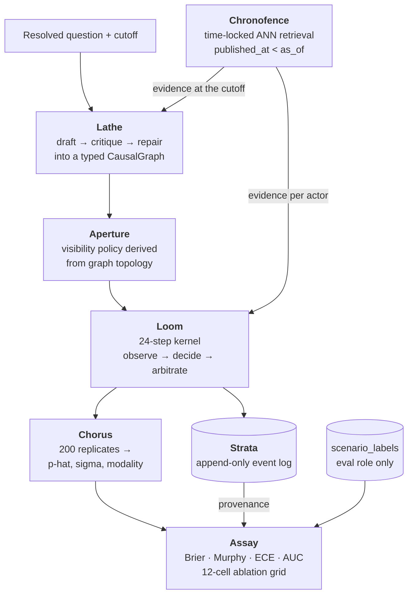
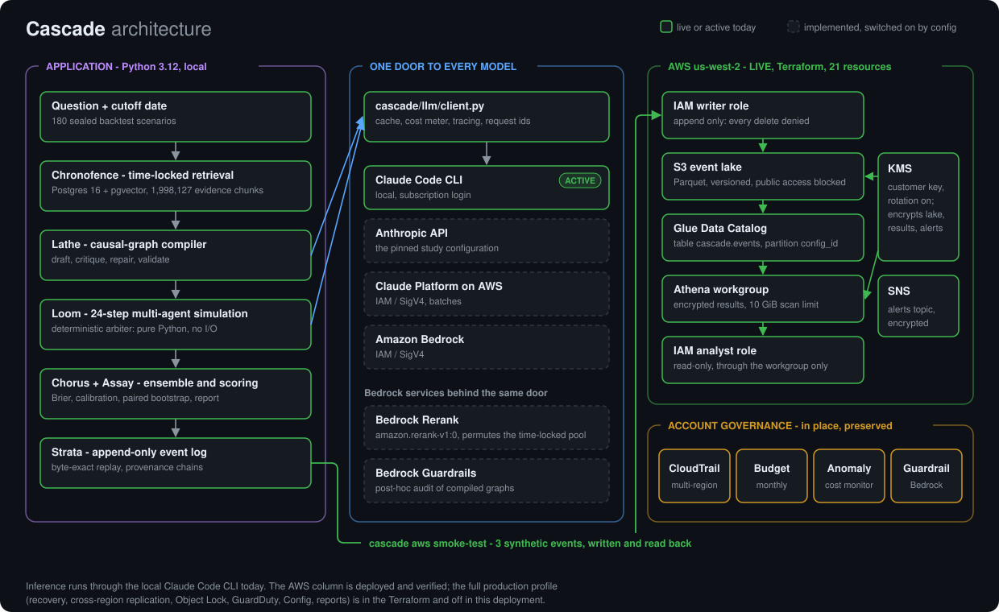
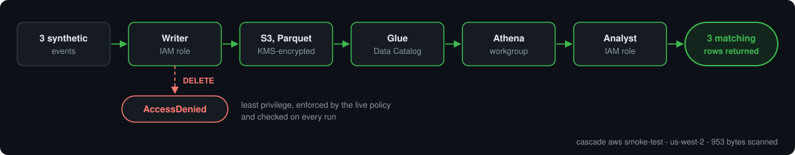
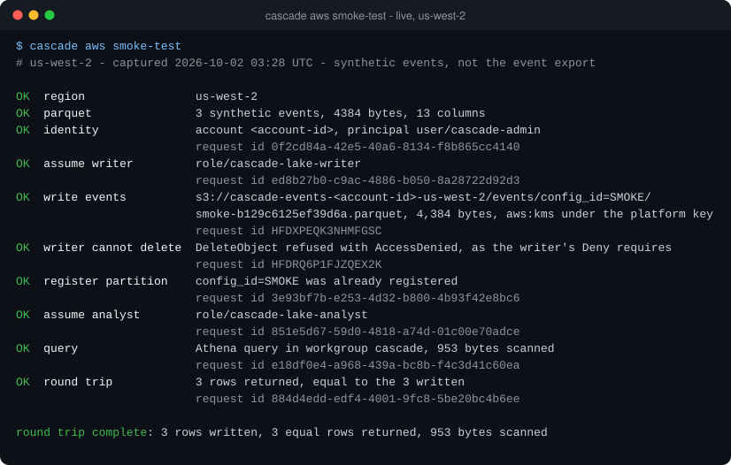
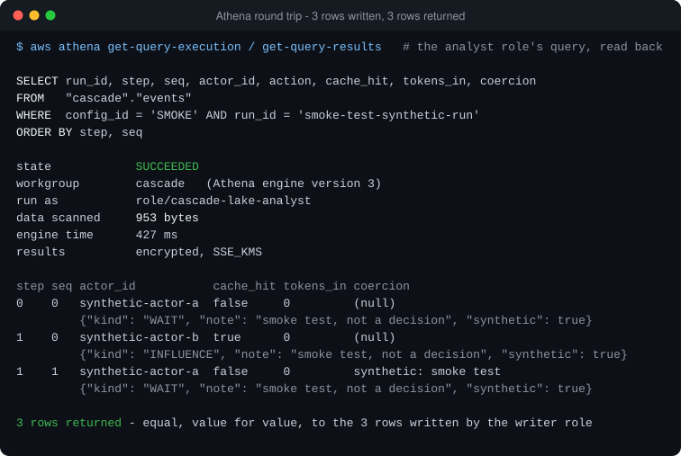
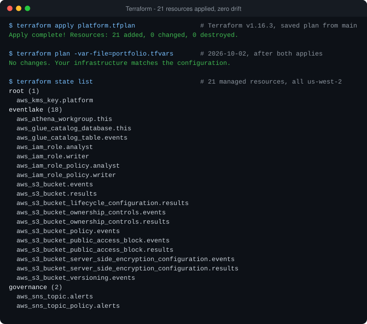
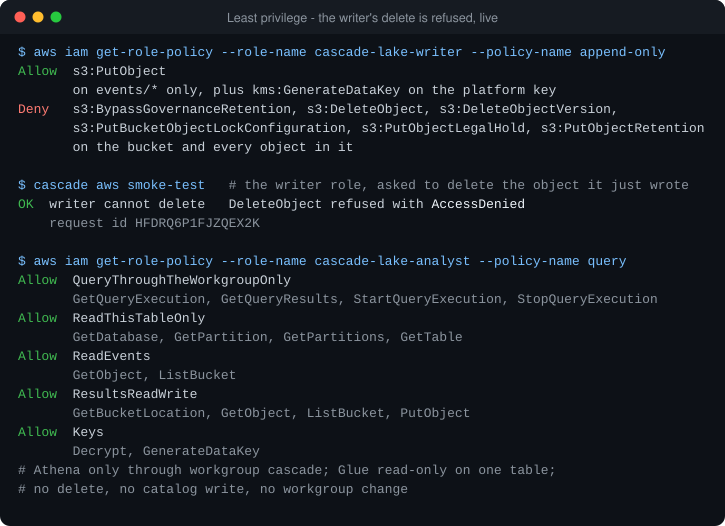
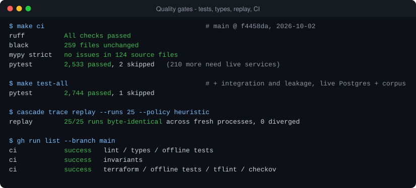

<h1 align="center">Cascade</h1>

<p align="center">
<<<<<<< HEAD
  <strong>Multi-agent causal simulation for strategic forecasting.</strong><br>
  Compile a question into a causal graph, run a seeded multi-agent simulation
  over it 200 times, and score the ensemble against what actually happened.
</p>

<p align="center">
  <a href="#status-what-is-measured-and-what-is-not"></a>
  <a href=".github/workflows/ci.yml"></a>
  <a href="#engineering-contract"></a>
  <a href="#engineering-contract"></a>
  
  
  <a href="LICENSE"></a>
</p>

---

## What this is

Most LLM forecasting systems ask a model for a probability. Cascade asks a
different question: **what would have to happen for this outcome to occur, who
would have to do it, and what do they each know?**

A question like *"will the regulator clear this merger before the deadline?"*
is compiled into a typed **causal graph** — 8–20 actors with objectives and
levers, 4–12 world factors with their own dynamics, and a monotone outcome
rule. That graph is then simulated for 24 steps: actors observe a *partial,
noisy, lagged* view of the world determined by their position in the graph,
choose actions, and a deterministic arbiter folds those actions into the next
world state. Run it 200 times from 200 seeds and the spread of terminal
outcomes is a forecast **and** a statement about how settled the question is.

Three properties are load-bearing, and each is enforced by a mechanism rather
than by discipline:

| | |
|---|---|
| **No hindsight** | Retrieval is time-locked at the database level. A query at cutoff *T* cannot return a document published at *T*. The simulation role has no `SELECT` grant on the outcomes table at all. |
| **Bit-exact replay** | One RNG per run, seeded once, drawn in a documented order. Every model call is content-addressed and replayed from disk. 25 stored runs re-run in fresh interpreters reproduce their event-log hash byte for byte. |
| **Full provenance** | Every agent decision is an append-only row carrying what it was responding to. `cascade trace explain` walks an outcome back to the exogenous shock that started it, in under a second. |

---

## Status: what is measured, and what is not

> **This section is the point of the README.** The project's first rule is that
> the report prints measured values and that no target is ever written into a
> report code path — enforced by a static check over every module on that path.
> The same rule applies here. Everything below is a number this repository
> produced; the headline study results **do not exist yet** and are not quoted.

**Nine milestones, M0–M8 complete, M9 (presentation) in progress.**

### Measured

| Quantity | Measured | Where |
|---|---|---|
| Backtest scenarios | **180**, YES rate **0.5000**, no domain above **25.0%** | M1 |
| Frozen split | sealed at `30d9c61d…`, re-hashed and asserted before any label is read | M1 |
| Climatology floor | Brier **0.250000** over the sealed set | M1 |
| Evidence corpus | **1,950,912** chunks across **492,270** documents, 0 NULL/future dates, 100% embedding coverage | M2 |
| Evidence coverage | every scenario covered at its own cutoff; median **67,590** admissible chunks in an 18-month window, median staleness **1 day** | M2 |
| Retrieval recall@20 | **0.9675** vs exhaustive search (criterion > 0.92) | M3 / M8 |
| Retrieval p95 | **90.92 ms** over 10,000 queries (criterion < 15 ms — **not met**, see [Limitations](#limitations)) | M3 / M8 |
| Poison-pill leakage | **0 of 500** planted post-cutoff documents retrieved, across all 180 cutoffs | M3 |
| Arbiter properties | bounded, conserving, permutation-invariant, monotone — all pass under Hypothesis | M5 |
| Replay determinism | **25/25** runs byte-identical across processes, 24.3 s | M8 |
| Provenance chain | complete to a root cause in **0.27 s** | M8 |
| Test suite | **1,331 passing**, 1 skipped; ruff, black and mypy strict clean over 98 modules | all |

### Not measured, and why

Five milestones' acceptance numbers need **540 Sonnet calls to compile 180
causal graphs**, and `CASCADE_ANTHROPIC_API_KEY` is unset in the environment
this was built in. Everything downstream of those graphs is built, wired and
tested against a stand-in decider; nothing downstream of the *credential* can
be measured.

- **No compiled graphs** → no agent-driven runs, so no Brier, no skill scores,
  no ablation deltas, no calibration curve.
- **The cost ledger cannot be reconciled** against Langfuse, because no stored
  run has spent anything. `cascade trace cost` **exits non-zero** rather than
  reporting that zero agrees with zero.
- Runs made with the stand-in decider are stamped `policy='heuristic'` in the
  database, and any report built from them says so **above** its own headline.

That last point is deliberate. A footnote is not a mechanism; the column is.

---

## How it works



```

Eight subsystems, each with one job:

| Subsystem | Package | Does |
|---|---|---|
| **Ledger** | `cascade/ledger/` | Builds and seals the 180-scenario registry with its base-rate and domain controls |
| **Chronofence** | `cascade/retrieval/` | Time-locked vector search — `as_of` has no default anywhere, in Python or SQL |
| **Lathe** | `cascade/decompose/` | Compiles a question into a validated `CausalGraph` (6 structural + semantic rules) |
| **Aperture** | `cascade/aperture/` | Derives who can see what from the graph's topology, with noise and lag per hop |
| **Loom** | `cascade/sim/` | The 24-step kernel and the deterministic arbiter — ~400 lines, no I/O, no LLM |
| **Chorus** | `cascade/ensemble/` | Fans out 36,000 runs in lockstep waves and collapses replicates into forecasts |
| **Assay** | `cascade/eval/` | Scoring, the 12-cell ablation grid, paired bootstrap, and the report artifact |
| **Strata** | `cascade/trace/` | Append-only event log, replay verification, provenance chains, cost ledger |

---

## Quickstart

**Prerequisites:** Docker, [uv](https://docs.astral.sh/uv/), Python 3.12.
No Anthropic key is needed for anything on this page.

```bash
git clone https://github.com/harshkvpatil98/cascade.git
cd cascade

make install          # uv sync --extra dev --extra kernel
make env              # writes .env from .env.example
make up               # Postgres 16 + pgvector 0.8, and Langfuse — waits for healthy
make migrate          # 16 forward-only SQL migrations
cascade doctor        # asserts the pinned stack and service health; exits 0 or tells you why
```

`cascade doctor` is the gate. It prints every pinned dependency with the
version actually installed, checks both services, and refuses to exit 0 if
anything has drifted.

> **Building the corpus or benchmarking retrieval?** Those paths need the
> embedding stack: `make install-full` adds torch and sentence-transformers
> (~2 GB). Nothing else on this page does — the model is imported lazily
> everywhere, and `cascade doctor` reports it as absent rather than failing.

---

## The 90-second demo

From a clean clone to a rendered causal trace. This runs entirely on the
deterministic stand-in decider — **no API key, no spend**. `make demo` runs all
five steps; they are spelled out here so you can see what each one proves.

```bash
# 1. Build and seal the 180-scenario registry  (~2 min, network)
cascade ledger build && cascade ledger seal

# 2. Run four ablation cells that need no compiled graph (~3 min)
#    C09-C12 are the "generic persona panel" arm, so they run without the compiler.
cascade eval grid --policy heuristic --cell C09 --cell C10 --cell C11 --cell C12 --limit 40

# 3. Prove the runs replay byte-identically in fresh processes
cascade trace replay --runs 25

# 4. Walk one outcome back to the exogenous shock that caused it
cascade trace explain          # --run is optional; defaults to the first stored run

# 5. Write the full report artifact
cascade report --headline C09
```

Step 4 prints:

```
outcome_score 0.53  <- factor 'momentum' moved last at step 23
  d0  step 23  actor=panelist_forecaster      COMMIT    +0.0007 on momentum
  d1  step 19  actor=panelist_advocate        COMMIT    +0.0007 on momentum
  ...
  d11 step  0  actor=panelist_forecaster      COMMIT    +0.0061 on momentum
  root  step  0  exogenous shock on 'resistance' +0.04
complete chain: 12 decision(s) to an exogenous shock at step 0
```

Step 5 writes `reports/study_<ts>/` with ten machine-readable files and four
SVG figures. Where a quantity could not be produced it is `null` in the JSON
and named in a **"Not produced"** section at the top of `headline.md` — never
filled in with the value the specification expects.

---

## Running the full study

Each phase is a subcommand, each is resumable, and each has a budget ceiling
that aborts rather than warns. Phases 3 onward need `CASCADE_ANTHROPIC_API_KEY`.

<details>
<summary><b>Phase-by-phase commands</b></summary>

### 1. Scenario registry (M1)
```bash
cascade ledger build       # 180 scenarios: base rate in [0.40, 0.60], no domain > 25%
cascade ledger seal        # writes manifest.sha256 — every later phase asserts it
cascade ledger verify
```

### 2. Evidence corpus (M2)
```bash
cascade corpus build       # resumable per unit; re-run until the target is met
cascade corpus verify      # exits 3 while short of 1.3M chunks
cascade corpus coverage    # evidence at each scenario's own cutoff; exits 3 when short
```

### 3. Time-locked retrieval (M3)
```bash
cascade retrieval index --drop-legacy   # one HNSW index per non-empty partition
cascade retrieval verify                # structural preconditions; exits 3 on drift
cascade retrieval bench                 # p50/p95/p99 + recall@20; exits 3 on a miss
make test-leakage                       # the poison-pill and date-monotonicity probes
```

### 4. Compile the causal graphs (M4) — *needs a key*
```bash
cascade compile build      # draft → critique → repair → validate, per scenario
cascade compile status     # graph statistics and the repair-retry histogram
cascade compile audit      # writes the seeded 20-graph human audit worksheet
```

### 5. Simulate (M5/M6) — *needs a key*
```bash
cascade simulate estimate --units 20    # dry run; exits 2 on a projected budget breach
cascade simulate all --wave 200         # the fan-out, batching each step across the wave
cascade ensemble collapse               # replicates → forecasts, label-blind
cascade ensemble convergence            # the replicate-count curve
```

### 6. Evaluate (M7) — *needs a key for 4 of 5 baselines*
```bash
cascade eval baselines --baseline climatology   # the one that needs no model
cascade eval estimate                            # baseline-phase dry run
cascade eval grid                                # all 12 Appendix C cells
cascade eval score --config-id C01
cascade eval significance
cascade report
```

### 7. Determinism and provenance (M8)
```bash
cascade trace status
cascade trace replay --runs 25          # byte-identical hashes across processes
cascade trace explain --run <run-id>    # provenance chain to a root cause
cascade trace cost                      # reconcile the ledger against Langfuse
=======
  <strong>Multi-agent causal simulation for strategic forecasting, built on time-locked evidence, byte-exact replay, and a live, Terraform-managed AWS analytics plane.</strong>
</p>

<p align="center">
  Cascade turns a real-world question into a causal graph of actors and forces, simulates it with
  LLM agents that can only see evidence published before the question's cutoff date, and scores the
  forecast against what actually happened. Every model call is recorded, every run replays to the
  same hash, and every decision traces back to its cause. Its event log has a home on AWS: an
  encrypted S3 lake behind Glue and Athena, deployed with Terraform and proven end to end by one command.
</p>

<p align="center">
  <a href="https://github.com/utkarsh430/cascade/actions/workflows/ci.yml"></a>
  
  
  
  
  
  <a href="LICENSE"></a>
</p>

<table align="center">
  <tr>
    <td align="center"><h3>2,533</h3>automated tests<br>passing</td>
    <td align="center"><h3>21</h3>live AWS resources,<br>Terraform-managed</td>
    <td align="center"><h3>3 / 3</h3>rows verified through<br>S3 → Glue → Athena</td>
    <td align="center"><h3>0</h3>Terraform drift<br>after deployment</td>
    <td align="center"><h3>1,027</h3>infrastructure security<br>checks, 0 failed</td>
    <td align="center"><h3>25 / 25</h3>simulation runs replayed<br>byte for byte</td>
  </tr>
</table>

<p align="center"><sub>These six numbers were re-measured on 2026-10-02 against <code>main</code> and the live AWS account. The outputs are in the <a href="docs/evidence/README.md">evidence pack</a>.</sub></p>

---

## What is Cascade?

Most AI forecasting asks a model for a probability. Cascade models **why** an outcome would
happen: who has to act, what each of them wants, and what each of them can see.

- **The problem.** Strategic questions — *will the regulator clear this merger before the
  deadline?* — turn on several actors reacting to each other. A single prompt hides that structure,
  cannot be replayed, and can quietly use knowledge from after the fact.
- **The system.** Cascade compiles a question into a typed causal graph (actors, objectives,
  world factors), runs a 24-step multi-agent simulation over it from many seeds, and turns the
  spread of outcomes into a forecast that is scored against the real resolution.
- **The intelligence layer.** LLM agents make the decisions; a deterministic arbiter applies them.
  All model access goes through one audited door with caching, cost metering and request-ID
  tracing, behind which four providers are interchangeable.
- **The AWS data and governance layer.** The simulation's event log lands in a KMS-encrypted S3
  lake, catalogued by Glue and queried through Athena, with separate writer and analyst roles —
  all deployed and managed by Terraform, alongside CloudTrail, budget and cost-anomaly monitoring.

## Highlights

- **A real AWS deployment, managed end to end by Terraform** — 21 resources in `us-west-2`,
  applied from a reviewed plan, with zero drift on the plan that followed.
- **Proven live in one command** — `cascade aws smoke-test` writes events as Parquet, queries
  them back through Glue and Athena, and checks the rows match: 3 written, 3 returned.
- **Least privilege that is tested, not assumed** — the writer role's `DELETE` is refused with
  `AccessDenied` on every run; the analyst role can only query, and only through the workgroup.
- **Evidence that cannot see the future** — retrieval over 1,998,127 evidence chunks is
  time-locked in the database itself, and the leakage suite plants post-cutoff documents to prove
  none comes back.
- **Byte-exact reproducibility** — 25 of 25 stored simulation runs replay to an identical
  event-log hash in fresh processes; any outcome can be walked back to its root cause.
- **One door to every model** — Claude Code CLI, Anthropic API, Claude Platform on AWS and Amazon
  Bedrock behind a single interface; switching provider is configuration, not code.
- **Amazon Bedrock integrated where it is safe** — Rerank as a permutation of the time-locked
  pool, Guardrails as a post-hoc audit, both with AWS request-ID observability.
- **Engineering rigor you can check** — 2,533 tests, `mypy --strict` over 124 modules, 193
  Terraform tests, 1,027 passing security checks, 54 architecture decision records, green CI.

## Architecture

<p align="center">
  
</p>

Solid green is running today; dashed is implemented and switched on by configuration. Inference
currently runs through the local Claude Code CLI; the AWS column is deployed and verified.
The deeper walkthrough is in [docs/ARCHITECTURE.md](docs/ARCHITECTURE.md).

<details>
<summary><b>The same architecture as a Mermaid diagram</b></summary>

```mermaid
flowchart TB
  subgraph APP["Cascade application - Python 3.12"]
    Q["Question + cutoff date"] --> R["Time-locked retrieval<br/>Postgres 16 + pgvector"]
    R --> G["Causal-graph compiler"]
    G --> SIM["24-step multi-agent simulation<br/>deterministic arbiter"]
    SIM --> EV["Ensemble, scoring, report"]
    SIM --> LOG[("Append-only event log<br/>byte-exact replay")]
  end

  subgraph LLM["One door to every model - llm/client.py"]
    DOOR["Cache, cost meter, tracing, request ids"]
    DOOR --> CLI["Claude Code CLI<br/><b>active</b>"]
    DOOR -. "by configuration" .-> ALT["Anthropic API<br/>Claude Platform on AWS<br/>Amazon Bedrock"]
    DOOR -. "opt-in" .-> RG["Bedrock Rerank<br/>Bedrock Guardrails"]
  end

  subgraph AWS["AWS us-west-2 - live - 21 Terraform resources"]
    W["IAM writer role<br/>append-only, delete denied"] --> S3[("S3 event lake<br/>Parquet, KMS-encrypted")]
    S3 --> GL["Glue Data Catalog<br/>cascade.events"]
    GL --> ATH["Athena workgroup<br/>encrypted results"]
    ATH --> AN["IAM analyst role<br/>read-only"]
  end

  G --> DOOR
  SIM --> DOOR
  LOG -->|"cascade aws smoke-test<br/>synthetic events"| W
>>>>>>> source-clean/main
```

</details>

<<<<<<< HEAD
### Cost

The study is priced at **$290 fully loaded** — $0.0035 marginal per run, and
$0.008 per run amortised over everything including the corpus, the compiler and
the whole ablation grid. Four levers make that possible: prompt caching, a
trajectory-prefix action cache, the Batch API, and a **deterministic arbiter**
that removes 864,000 model calls on its own.

Every phase has a hard ceiling in `configs/base.yaml`. A breach writes a
resumable checkpoint and exits `2`. Nothing warns.

---

## Repository layout

```
cascade/
├─ cascade/              # the package — 98 modules, mypy strict
│  ├─ ledger/            # M1  scenario registry and manifest sealing
│  ├─ corpus/            # M2  fetch → dedupe → chunk → embed → index
│  ├─ retrieval/         # M3  Chronofence: time-locked ANN + bench + leakage probes
│  ├─ decompose/         # M4  Lathe: the CausalGraph compiler and its validator
│  ├─ aperture/          # M6  visibility policy derivation and projection
│  ├─ sim/               # M5  Loom: the 24-step kernel and the pure arbiter
│  ├─ ensemble/          # M6  Chorus: fan-out, aggregation, dip test
│  ├─ eval/              # M7  Assay: metrics, ablation grid, statistics, report
│  ├─ trace/             # M8  Strata: event log, replay, provenance, cost ledger
│  └─ llm/               # the single model call site: record / replay / live
├─ configs/              # base.yaml + the 12 ablation cell overlays
├─ migrations/           # 16 numbered, forward-only SQL migrations
├─ docs/adr/             # 27 architecture decision records
├─ tests/                # unit · property · integration · leakage · determinism
└─ reports/              # generated study artifacts
```

---

## Engineering contract

`CLAUDE.md` is the contract this repository is built against: the invariants,
the pinned stack, and a build log with one entry per milestone recording what
shipped, what the acceptance numbers **actually were**, and what was deferred.

### The nine invariants

Each is enforced by a test, not by intention.

1. **`as_of` is never defaulted** — not in Python, not in SQL, not in a test helper.
2. **The simulation never reads `scenario_labels`** — enforced by a Postgres grant, not by code review.
3. **The arbiter contains no LLM call and no I/O** — asserted statically over its imports.
4. **One RNG per run**, seeded once, drawn in a fixed documented order.
5. **One LLM call site** — a grep for the SDK import anywhere else fails CI.
6. **The event log is append-only** — no `UPDATE`, no `DELETE`, ever.
7. **All iteration over collections is sorted** — dict order is a nondeterminism vector.
8. **Every phase is resumable** — checkpoint and skip completed units on restart.
9. **No target value is ever written into a report code path** — a static check parses every module on that path and fails on any literal from the measurement contract.

### Quality gates

```bash
make ci          # ruff + black + mypy strict + the offline test suite
make test        # offline only — no services needed
make test-all    # adds integration and leakage (needs `make up`)
```

| Gate | Status |
|---|---|
| ruff | clean |
| black | clean |
| mypy strict | clean, 98 modules |
| pytest | 1,331 passing, 1 skipped |

The suite is 72 files and about 17,000 lines across five categories: unit,
Hypothesis property tests, integration against live Postgres, **leakage**
probes that plant post-cutoff documents and assert none is ever retrieved, and
**determinism** tests that re-run a scenario in subprocesses under different
hash seeds.

---

## Limitations

Stated plainly, because a result that hides these is not a result.

1. **The headline study numbers do not exist.** No causal graph has been
   compiled by a model. Every figure in [Status](#status-what-is-measured-and-what-is-not)
   comes from the infrastructure or from runs made with a deterministic
   stand-in, which the database stamps as such.
2. **Retrieval p95 misses its budget — 90.92 ms against 15 ms.** The budget was
   derived for per-step retrieval (4.2M searches); a later decision moved
   retrieval to once per *(scenario, actor)*, roughly 2,520 searches, so the
   study's entire retrieval cost is about four minutes. The criterion is still
   missed and `cascade retrieval bench` still exits 3. The remaining gap is the
   partition count, measured at **3.9 ms fixed + 0.34 ms per partition**.
3. **Metaculus is unavailable** without a token, so the registry is sourced
   from Polymarket, Manifold and a curated file — a documented deviation from
   the specification's "~90 from Metaculus".
4. **The 16 curated scenarios are not independently verified.** They are
   authored from the public record and must be checked before publication: a
   curated label nobody can check is indistinguishable from an invented one.
5. **Parametric memorization is unmeasured.** The probe is implemented and
   CLI-wired but needs a key. A model that already knows how a 2018 merger
   resolved is a floor no amount of time-locking removes, and the number
   belongs beside the headline Brier rather than in a footnote.
6. **GDELT contributed nothing.** Its API serves a rolling recent window rather
   than the archive, and this network is rate-limited beyond practical use.

---

## Design decisions

27 architecture decision records live in [`docs/adr/`](docs/adr/) — see the
[index](docs/adr/README.md). Fifteen correct defects in the specification;
three correct defects found in this build. A few that shaped the system:

| ADR | Decision |
|---|---|
| [0002](docs/adr/0002-chronofence-security-definer.md) | `chronofence_search` needs `SECURITY DEFINER`; as specified the app role gets a permission error on its own function |
| [0005](docs/adr/0005-role-grants-deny-by-default.md) | Role grants deny by default — the spec's `REVOKE … FROM cascade_sim` is a no-op |
| [0015](docs/adr/0015-run-rng-draw-plan.md) | The whole step's randomness is drawn at once, so an ablation runs the identical stream through a different policy |
| [0019](docs/adr/0019-evidence-in-the-cached-prefix.md) | Evidence is retrieved once per (scenario, actor), not per step — 4.2M searches become 2,520 |
| [0023](docs/adr/0023-corpus-unit-granularity-and-demand-ordering.md) | Ingest order is a correctness concern: chronological units left a 1.76M-chunk corpus covering the wrong decade |
| [0025](docs/adr/0025-ablation-factors-a-and-c.md) | Two of four ablation factors were configuration fields nothing read — six of twelve cells would have been duplicates |
| [0026](docs/adr/0026-hnsw-and-bounded-candidate-pool.md) | HNSW replaces IVFFlat, and a parameterised `LIMIT` in a non-inlinable function cost 4× |

---

## Contributing

See [CONTRIBUTING.md](CONTRIBUTING.md). The short version: one milestone per
change, acceptance criteria written as failing tests first, and if a criterion
cannot be met — **stop and report the measured value with a diagnosis**. Do not
relax the criterion, do not add a tolerance, do not mark it approximately
passing.

## License

[MIT](LICENSE).
=======
## Proven live on AWS

`cascade aws smoke-test` is a deterministic, end-to-end proof that the deployed lake works, run
as the lake's own IAM roles rather than as an administrator.

<p align="center">
  
</p>

| Measured in the latest run (2026-10-02, `us-west-2`) | |
|---|---|
| Events written, as the **writer role** | **3**, as one Parquet file — 4,384 bytes, 13 columns, encrypted with `aws:kms` |
| Writer attempts to delete the object it just wrote | **refused: `AccessDenied`** — least privilege enforced by the live policy |
| Catalog | partition registered in the Glue table `cascade.events` |
| Query, as the **analyst role**, through the Athena workgroup | **SUCCEEDED** — 953 bytes scanned, 427 ms engine time, results encrypted |
| Round trip | **3 rows returned, equal value for value to the 3 written** |
| Traceability | an AWS request ID recorded for every call |

<p align="center">
  
</p>

The smoke test uses three clearly labelled synthetic events: it proves the S3, KMS, Glue, Athena
and IAM path end to end. Continuous export of the full event log is the next step.

## Evidence

Captured output from the live account and from `main`, sanitized and indexed in
[docs/evidence](docs/evidence/README.md).

<table>
  <tr>
    <td width="50%"><a href="docs/evidence/athena-roundtrip.svg"></a><br><sub><b>Athena round trip</b> — the analyst role's query and the three rows it returned.</sub></td>
    <td width="50%"><a href="docs/evidence/terraform-no-drift.svg"></a><br><sub><b>Terraform</b> — 21 resources applied, and no changes on the next plan.</sub></td>
  </tr>
  <tr>
    <td width="50%"><a href="docs/evidence/least-privilege.svg"></a><br><sub><b>Least privilege</b> — the writer's policy, and its delete refused live.</sub></td>
    <td width="50%"><a href="docs/evidence/quality-gates.svg"></a><br><sub><b>Quality gates</b> — tests, strict typing, byte-exact replay and CI.</sub></td>
  </tr>
</table>

## Security by design

| Control | How it is enforced | How it is verified |
|---|---|---|
| Encryption at rest | One customer-managed KMS key, rotation on, for the event lake, Athena results and the alerts topic | Read back from the live buckets and key |
| No public data | All four S3 public-access blocks on every bucket; TLS-only bucket policy | Read back live; asserted by Terraform tests |
| Append-only event lake | The writer role may `PutObject` and is explicitly denied every delete and lock override | **Tested live on every smoke-test run: `DeleteObject` → `AccessDenied`** |
| Read-only analytics | The analyst role queries one table, through one Athena workgroup that enforces encryption and a 10 GiB scan limit | The smoke test runs its query as that role |
| No hindsight | `published_at < as_of` enforced inside the database; the simulation's role has no grant on the outcomes table | Leakage suite: planted post-cutoff documents are never retrieved |
| Prompt-injection resistance | Retrieved documents are quoted in a frame they cannot forge | Measured: obeyed on 20 of 30 scenarios before, 0 of 30 after |
| Model-output screening | Amazon Bedrock Guardrails audit compiled graphs after the fact, never silently altering them | `cascade aws check` resolves the guardrail live |
| Observability | Provider and AWS request IDs kept on every call, recording and trace | Shown in the smoke-test output |
| Infrastructure scanning | Checkov, TFLint and 193 mock-provider Terraform tests in CI | 1,027 passed, 0 failed |
| Account governance | CloudTrail, an AWS Budget and Cost Anomaly Detection in the account | Read back live, unchanged by the deployment |

## Infrastructure: one codebase, two profiles

The same Terraform supports a cost-efficient demonstration profile while retaining the
production-grade recovery and governance modules. Every production tier is a switch, on by
default; the committed [`portfolio.tfvars`](infra/terraform/envs/platform/portfolio.tfvars)
turns them off for the live demo.

| Capability | Full configuration (in the codebase) | Live portfolio deployment |
|---|:-:|:-:|
| KMS key, S3 event lake, Athena results bucket | ✅ | ✅ **live** |
| Glue catalog and table, Athena workgroup | ✅ | ✅ **live** |
| Writer and analyst IAM roles | ✅ | ✅ **live** |
| SNS alerts topic | ✅ | ✅ **live** |
| S3 Object Lock on the lake and reports | ✅ | available, off |
| Tier-0 recovery archive with cross-region replication | ✅ | available, off |
| Reports bucket | ✅ | available, off |
| GuardDuty and AWS Config | ✅ | available, off |
| Isolated VPC, Aurora PostgreSQL Serverless v2, Fargate tasks | ✅ | available, not deployed |

Three roots, 15 modules, pinned Terraform 1.16.3. Standing cost of the live deployment is one
KMS key; everything else bills only when used. Details: [infra/terraform](infra/terraform/README.md)
and [ADR-0054](docs/adr/0054-a-portfolio-deployment-profile.md).

## Tech stack

| Layer | What is used |
|---|---|
| **AI / LLM** | Claude (Haiku 4.5 agents, Sonnet 4.6 compiler) through a four-provider abstraction: Claude Code CLI (active), Anthropic API, Claude Platform on AWS, Amazon Bedrock; Bedrock Rerank and Bedrock Guardrails |
| **Application** | Python 3.12, LangGraph, Pydantic v2, Typer + Rich, PostgreSQL 16 + pgvector, `bge-small-en-v1.5` embeddings, PyArrow |
| **AWS** | S3, KMS, Glue, Athena, IAM, SNS, CloudTrail, Budgets, Cost Anomaly Detection, Bedrock |
| **Infrastructure** | Terraform 1.16.3 (AWS provider 6.65.0), TFLint, Checkov, Docker Compose |
| **Engineering** | pytest + Hypothesis, mypy strict, ruff, black, uv, GitHub Actions |

## Demo

The fastest way to see it work, with AWS credentials for the deployed account:

```bash
cascade aws check         # identity, guardrail and reranker resolve; invokes nothing
cascade aws smoke-test    # 3 events → S3 → Glue → Athena → 3 matching rows
```

`check` prints four green rows. `smoke-test` prints ten, ending in
`round trip complete`, with the writer's delete refused along the way and a request ID
beside every AWS call. Both take seconds and cost a fraction of a cent.

No AWS account? The application has its own no-key demo, on the deterministic stand-in agents:

```bash
make demo                 # registry → simulation cells → 25-run replay → causal trace → report
```

A timed five-minute walkthrough, with a fallback that needs no network, is in
[docs/DEMO.md](docs/DEMO.md).

## Quick start

Prerequisites: Docker, [uv](https://docs.astral.sh/uv/) and Python 3.12.

```bash
git clone https://github.com/utkarsh430/cascade.git && cd cascade

make install      # uv sync --extra dev --extra kernel --extra aws
make env          # writes .env from .env.example
make up           # Postgres 16 + pgvector and Langfuse, waits for healthy
make migrate      # 21 forward-only SQL migrations
cascade doctor    # pinned stack, provider, AWS surfaces, service health
make ci           # ruff, black, mypy strict and the offline test suite
```

For the AWS smoke test, add the Parquet writer:
`uv sync --extra dev --extra kernel --extra aws --extra analytics`.
To deploy the lake to your own account, follow the
[infrastructure runbook](infra/terraform/README.md).

## Repository map

```
cascade/
├─ cascade/                 # the application package, mypy strict
│  ├─ retrieval/            # time-locked hybrid retrieval and reranking
│  ├─ decompose/            # the causal-graph compiler and validator
│  ├─ sim/  aperture/       # the simulation kernel, the arbiter, who can see what
│  ├─ ensemble/  eval/      # ensembles, scoring, statistics, the report
│  ├─ trace/                # event log, replay, provenance, the AWS lake smoke test
│  └─ llm/                  # the single model door: four providers, Bedrock services
├─ infra/terraform/         # 3 roots, 15 modules, mock-provider tests
├─ docs/                    # architecture, demo script, evidence, results, 54 ADRs
├─ migrations/              # forward-only SQL
├─ configs/                 # base configuration and experiment overlays
└─ tests/                   # unit · property · integration · leakage · determinism
```

## Current validated scope

What exists and has been verified today:

| Area | Validated |
|---|---|
| **AWS analytics plane** | Deployed by Terraform in `us-west-2`; 21 resources; no drift; S3 → Glue → Athena round trip proven with synthetic events as the lake's own roles |
| **Inference** | Runs through the locally authenticated Claude Code CLI; Claude Platform on AWS, the Anthropic API and Bedrock are implemented behind the same interface and tested against the real SDKs |
| **Bedrock services** | Rerank and Guardrails integrated and tested against the service models; the account's guardrail and the rerank model resolve live |
| **Evidence engine** | 1,998,127 chunks from 317,780 documents, fully embedded, time-locked at the database |
| **Simulation platform** | 180 sealed backtest scenarios; 2,850 stored runs and 520,455 logged decisions; 25 of 25 replays byte-identical |
| **Evaluation harness** | The first full study ran end to end — 360 simulations, 66,231 model calls — and reports what it measured: on 36 development scenarios Cascade (Brier 0.2197), a single model (0.2069) and the base rate (0.2500) are statistically indistinguishable. The held-out test set is untouched |

The complete record, including every measured figure and its boundaries, is in
[docs/RESULTS.md](docs/RESULTS.md).

## Next evolution

- Continuous export of the simulation event log into the lake
- Automated partition registration for new experiment cells
- Enabling Claude Platform on AWS as the inference provider
- A larger evaluation run on the held-out test set

## Documentation

| | |
|---|---|
| [Architecture](docs/ARCHITECTURE.md) | Components, data flow, IAM separation, Terraform profiles, the provider layer |
| [Demo script](docs/DEMO.md) | A five-minute presentation, with exact commands and an offline fallback |
| [Evidence pack](docs/evidence/README.md) | Every proof artifact, what produced it and what it shows |
| [Results](docs/RESULTS.md) | Every measured number, and the boundaries of what was measured |
| [Infrastructure runbook](infra/terraform/README.md) | Deploying, the two profiles, cost |
| [Decision records](docs/adr/README.md) | 54 ADRs: each decision, its evidence and its cost |
| [Threat model](docs/architecture/threat-model.md) · [Well-Architected review](docs/architecture/well-architected.md) | Security and operations in depth |
| [Changelog](CHANGELOG.md) · [Contributing](CONTRIBUTING.md) | The milestone-by-milestone record, and how to work on the project |

## License

[MIT](LICENSE)
>>>>>>> source-clean/main
